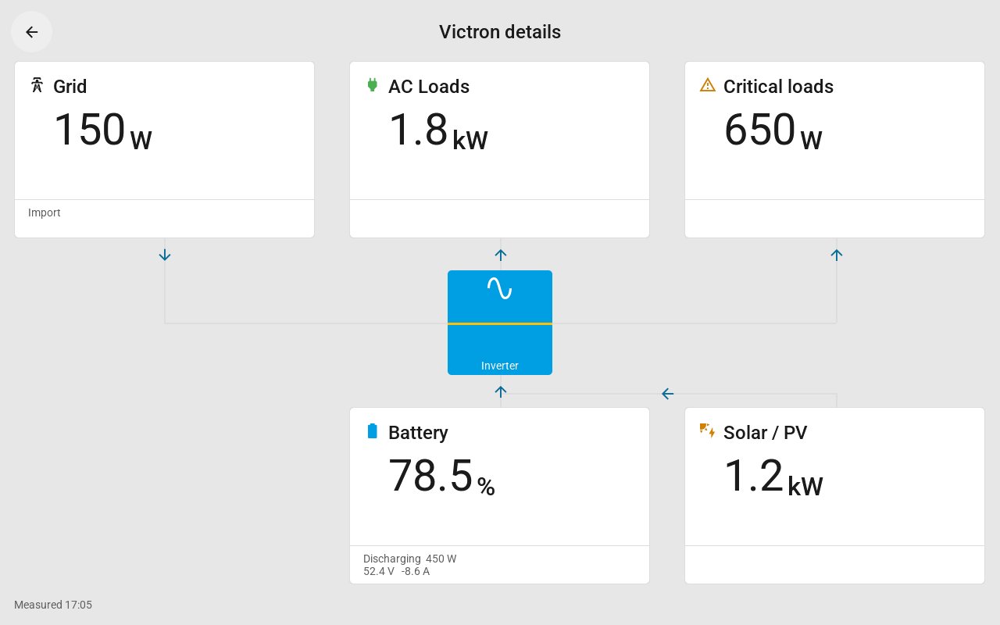

# Victron Tessera

Een native Tessera-dashboard voor je eigen Victron-sensoren in Home Assistant. De eerste uitwerking richt zich op een 10,1-inchscherm en een eenfase-installatie.

## Instellen

1. Zorg dat je Victron-sensoren in Home Assistant de juiste waarden tonen.
2. Maak de Home Assistant-templatesensor uit het voorbeeld in de [Engelse README](README.md#home-assistant-dashboard-sensor) en vervang de voorbeeldnamen door je eigen sensor-ID's.
3. Voeg in Tessera bij **Plugins > Toevoegen met een link** deze URL toe: `https://github.com/vajpeters/Victron-Tessera`.
4. Kies je scherm en selecteer **Opslaan en bouwen**. Bij deze firmwarebouw hoef je geen sensoren te kiezen.
5. Plaats **Victron-dashboard** in de indeling en kies de dashboardsensor in de instellingen van de tegel.
6. Kies daar ook een van de gewone Tessera-achtergrondkleuren.
7. Gebruik op het liggende 10,1-inchscherm bij voorkeur 5x4. De pagina zelf heeft een 5x5-raster. Tessera noemt een tegel die exact het hele 5x5-raster vult `full`; de plug-inbewerker biedt dat formaat nog niet aan.

Je kunt de dashboardsensor en achtergrondkleur later wijzigen zonder de firmware opnieuw te bouwen. Iedere tegel kan een eigen dashboardsensor gebruiken.

## Waarom één dashboardsensor?

Tessera biedt een plug-integel momenteel één keuzelijst voor een Home Assistant-entiteit. Daarom staat het accupercentage in de status van één templatesensor en staan accuvermogen, zonneproductie, AC-verbruik, netvermogen en de optionele waarden in attributen. Home Assistant blijft bepalen welke bestaande sensoren daarvoor worden gebruikt.

De verplichte attributen zijn `battery_power`, `solar_power`, `load_power` en `grid_power`, elk met een bijbehorend `*_unit`-attribuut. `battery_voltage`, `battery_current`, `critical_load_power` en `source_time` zijn optioneel. Zie de Engelse README voor het volledige contract en een kopieerbaar YAML-voorbeeld.

Vermogen mag W, kW of MW zijn; kWh en VA worden niet als W gelezen. De plug-in telt geen fasen of zonnebronnen op en verzint geen ontbrekende waarden. Voor een driefasesysteem geef je zelf correcte totaalsensoren door.

## Victron-indeling

Ruime tegels en de detailkaart tonen Net, AC-verbruik en Kritieke verbruikers bovenaan, een omvormersymbool in het midden, en Accu en Zon/PV onderaan. De plug-in werkt op het 5x5-paginaraster; 5x4 liggend en 4x5 staand passen binnen dat raster. Kleine tegels gebruiken de compacte weergave. De gekozen Tessera-kleur vult de achtergrond en kleurt de lichte panelen subtiel mee.

Pijlen verschijnen alleen bij geldige, verse metingen boven 1 W. Het omvormersymbool meldt geen gemeten bedrijfsstatus. Historische grafieken, MPPT-details en andere ontbrekende gegevens uit het Victron-voorbeeld worden niet nagebootst.

Je hebt geen VRM-token nodig. De bestaande Home Assistant-integratie verzorgt de koppeling met Victron.
